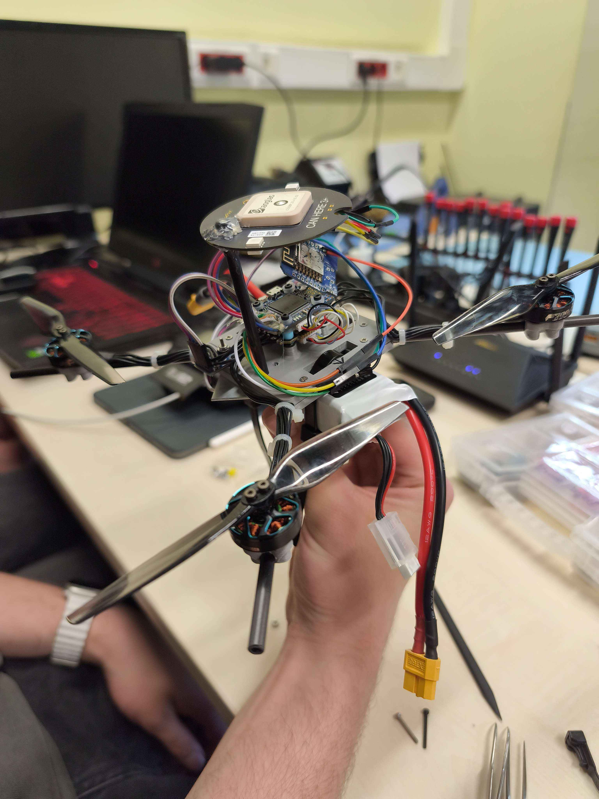
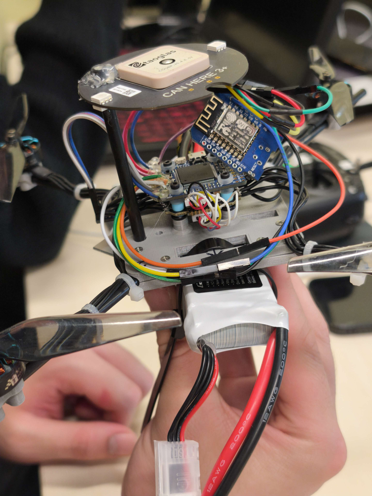
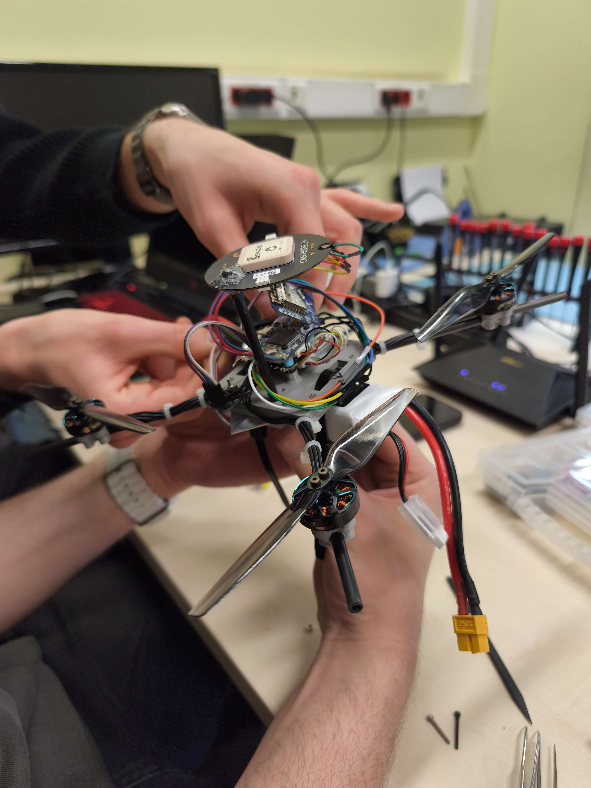
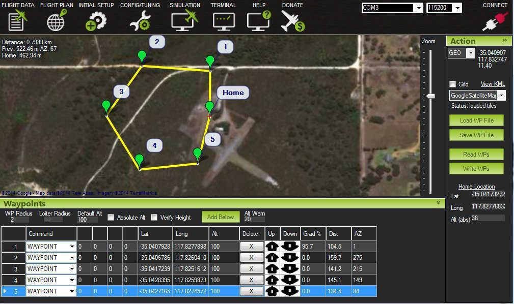
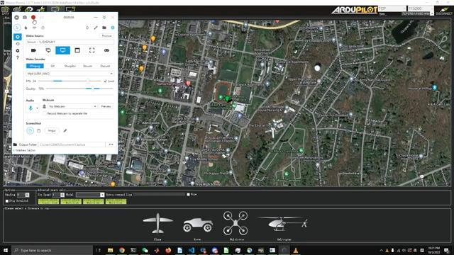
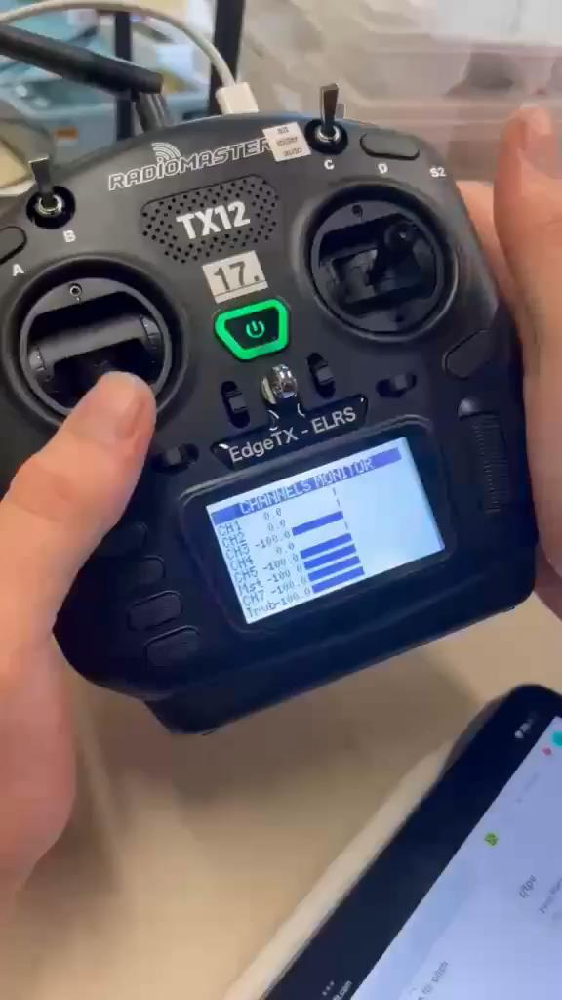

# Drone Integration and Mission Planning with ArduPilot

A team project combining hands-on quadcopter assembly, flight-system configuration and mission planning. We integrated the drone hardware, configured the radio-control connection and carried out a short indoor flight test under manual RC control.

**Authors:** Martyna Rydczak, Dawid Zieliński and Szymon Rybka  
**Project supervisor:** Iman Esfandyiar  
**Poznan University of Technology**

**ArduPilot · Mission Planner · Linux · RC configuration · Hardware integration**

## Goal and scope

The goal was to become familiar with the ArduPilot platform and prepare a drone for testing. Our work covered manual assembly, component integration, software setup, wireless communication and mission planning in Mission Planner.

The planned autonomous mission and SITL demonstration were separate from the physical flight test. The real drone was flown manually indoors; outdoor flight tests and execution of the planned autonomous mission on the physical drone were not carried out.

## Team contribution

> **Shared development**  
> Martyna Rydczak, Dawid Zieliński and Szymon Rybka worked together on assembly, configuration, integration and testing. Responsibilities overlapped throughout the project, so the work is presented as a joint team effort.

## Assembly and integration

We manually assembled the drone and connected the flight controller, GPS, wireless modules, ESCs and battery. We checked the component connections and prepared the assembled platform for configuration and testing.

<table>
<tr><th>Component integration</th><th>Assembly and connection checks</th></tr>
<tr><td></td><td></td></tr>
</table>

## Configuration and mission planning

### ArduPilot and Mission Planner

The project included Linux setup, ArduPilot configuration and mission planning in Mission Planner. The presentation documents a SITL demonstration with takeoff, waypoints and landing, along with the map view and telemetry display.

<strong>SITL demonstration</strong>

The simulated mission demonstrates the planning workflow. It is not evidence that the physical drone completed the same autonomous mission.

### Radio-control connection

We configured the physical radio transmitter, checked its connection to the drone and verified the drone's response to control inputs before the indoor flight test.

The transmitter is a **RadioMaster TX12** with an **EdgeTX / ELRS** label. Its exact hardware revision has not been verified. The transmitter is separate from the onboard flight controller.

The project presentation also records configuration of WiFi modules and a router for remote communication.

## Testing and results

The integrated drone successfully took off during a short indoor test under manual RC control. The team checked the radio connection and response to commands. Outdoor testing was not conducted.

| Recording | Link |
|---|---|
| Short indoor test recording | [Open MP4](media/videos/indoor-test-short.mp4?raw=true) |
| Longer indoor test recording | [Open MP4](media/videos/indoor-test-long.mp4?raw=true) |

The recordings document the physical prototype tests. They do not represent execution of the autonomous waypoint mission.

The project provided practical experience in integrating electronics and propulsion components, configuring a flight system and troubleshooting communication between hardware and software.

## Project materials

- [Project presentation](docs/project-presentation.pdf)
- [Image and recording index](media/README.md)

This repository documents the project through photographs, recordings and the presentation. Source code, exported mission files, parameter backups and flight logs are not included in the supplied materials.
